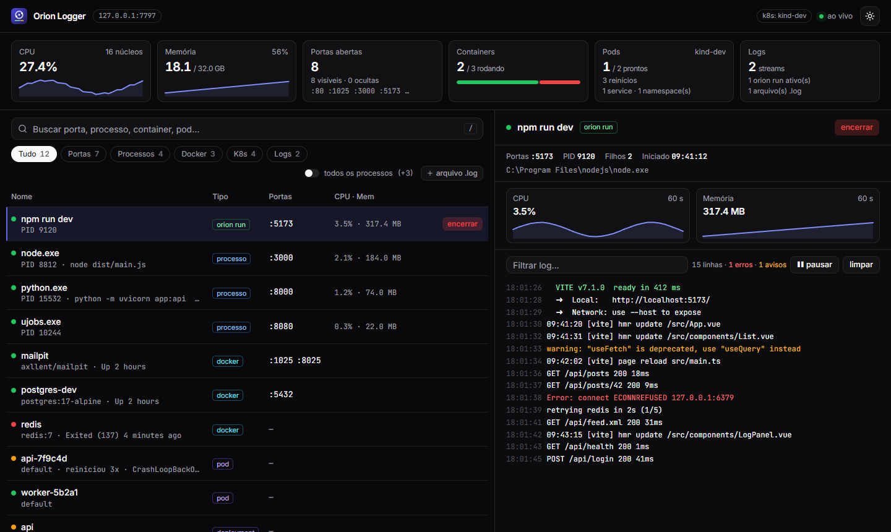

<p align="center">
  
</p>

<h1 align="center">Orion Logger</h1>

<p align="center">
  Um raio-X da sua máquina de desenvolvimento: portas abertas, processos, containers Docker e o que roda no Kubernetes, com logs ao vivo e ações de um clique. Tudo numa tela, num único <code>.exe</code>.
</p>

<p align="center">
  
  
  
  
  
</p>

<p align="center">
  
</p>

> [!NOTE]
> **Tudo local.** O painel escuta só em `127.0.0.1` e nada sai do seu computador: nada de conta, telemetria ou nuvem. Até as fontes vão embutidas no binário.

## Funcionalidades

- **Lista única** com portas, processos, containers Docker e pods, services e deployments do Kubernetes, atualizada a cada 2 segundos.
- **Busca enquanto digita** por porta, nome, imagem, namespace ou PID (`/` foca a busca), e filtros por tipo: Tudo · Portas · Processos · Docker · K8s · Logs.
- **Logs ao vivo** no painel da direita, com filtro, pausar e limpar:
  - containers Docker, como `docker logs -f`;
  - pods do Kubernetes, como `kubectl logs -f`;
  - comandos iniciados com `orion run`;
  - qualquer arquivo `.log` que você adicionar, como `tail -f`.
- **Ações, sempre com confirmação**: encerrar processo (a árvore inteira, como `taskkill /T /F`), iniciar, parar e reiniciar container, apagar pod.
- **CPU e memória** da máquina e do item selecionado, com gráfico dos últimos 60 segundos.
- **Fonte fora do ar não quebra nada**: sem Docker ou sem `kubeconfig`, o filtro mostra "indisponível" com o motivo e o resto continua funcionando.
- **Tema claro e escuro.**

## Começando

Baixe o `orion.exe` e rode:

```powershell
.\orion.exe
```

O painel abre no navegador. Para usar outra porta ou não abrir o navegador:

```powershell
.\orion.exe --port 8000 --no-browser
```

Para ver os logs de um processo seu, inicie pelo Orion:

```powershell
.\orion.exe run npm run dev
.\orion.exe run go run ./cmd/api
```

O `orion run` funciona como rodar o comando direto: a saída aparece no terminal, o Ctrl+C encerra e o código de saída é repassado. Se o painel não estiver aberto, ele sobe sozinho em segundo plano.

Não precisa de Node, Docker CLI nem `kubectl`.

### Compilando

Requer Go 1.27+ e Node 24+.

```powershell
.\scripts\build.ps1
```

## Como funciona

```
processos + portas (gopsutil)  ┐
Docker (Engine API, named pipe)├→  coletor a cada 2 s  →  SSE  →  navegador (Vue)
Kubernetes (client-go)         ┘

orion run / .log / docker logs / kubectl logs  →  SSE  →  painel de logs
```

- **Segurança**: toda requisição exige um token aleatório criado ao abrir (vai na URL do navegador e depois fica num cookie HttpOnly). `Host` e `Origin` são verificados, então outros sites abertos no navegador não conseguem chamar o painel.
- **Encerrar sem errar o alvo**: antes de encerrar, o Orion confere se o PID ainda é o mesmo processo listado (pelo horário de criação), para nunca matar um PID reaproveitado. Processos protegidos mostram erro de permissão.
- **Uma linha por processo**: o `orion run` junta na mesma linha os processos filhos (`npm → node`), com as portas deles e CPU e memória somadas.
- **Log pesado não trava**: as linhas chegam em lotes, são desenhadas uma vez por quadro e a tela guarda só as últimas 5.000.
- **Acentos no `cmd`**: saída em cp850 é convertida, então "versão" não vira "vers�o".

### Estrutura

```
cmd/orion            ponto de entrada: abrir o painel e orion run
internal/server      API (Gin), token, streams SSE
internal/inventory   processos e portas, Docker, Kubernetes, coletor
internal/logs        guarda as linhas e acompanha arquivos .log
internal/actions     encerramento seguro da árvore de processos
internal/runner      orion run
web/                 interface (Vue 3 + Tailwind + shadcn-vue), embutida no .exe
```

Testes: `go test ./...` e `npm --prefix web test -- --run`.

## Limitações conhecidas

- **Logs de processos que o Orion não iniciou não aparecem.** O Windows não deixa ler a saída de um processo que já está rodando. Esses processos mostram os detalhes e podem ser encerrados; para ver o log, rode com `orion run` ou acompanhe um `.log`.
- **Feito para Windows 11.** Linux e macOS não foram testados.
- **Só a máquina local** e só o contexto atual do `kubeconfig`.
- **Sem histórico**: mostra o agora; os gráficos de 60 segundos ficam só no navegador.
- O binário tem cerca de 60 MB, a maior parte do cliente do Kubernetes.

## Créditos

- Servidor: [Gin](https://gin-gonic.com). Processos: [gopsutil](https://github.com/shirou/gopsutil). Docker: [Moby](https://github.com/moby/moby). Kubernetes: [client-go](https://github.com/kubernetes/client-go).
- Interface: [Vue](https://vuejs.org), [Tailwind CSS](https://tailwindcss.com) e [shadcn-vue](https://www.shadcn-vue.com). Ícones: [Lucide](https://lucide.dev).
- Fontes: [Inter](https://rsms.me/inter/) e [JetBrains Mono](https://www.jetbrains.com/lp/mono/) (SIL Open Font License).
